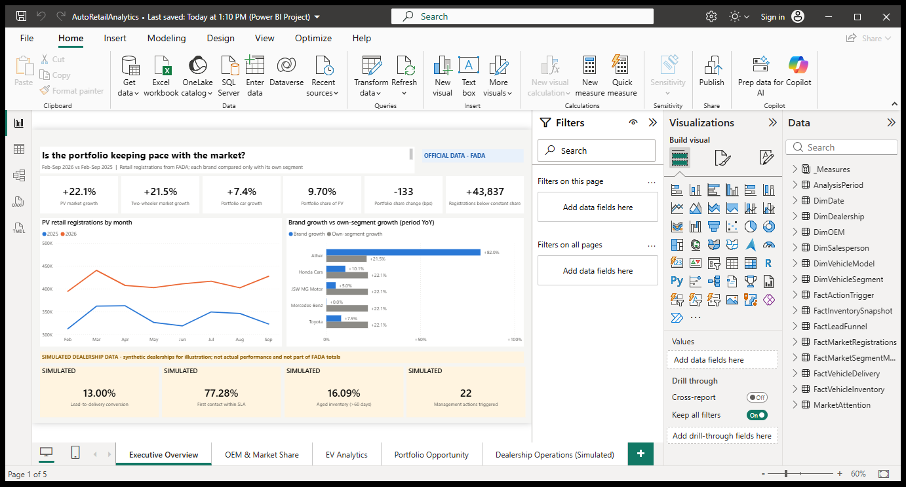

# Auto Retail Market Intelligence & Dealership Analytics

An analytics engineering project for a **hypothetical multi-brand dealer group** selling Toyota, Honda Cars, JSW MG Motor, Mercedes-Benz and Ather in India. It has two deliberately separate layers:

| Layer | Question | Data |
|---|---|---|
| **A. Market intelligence** | Is the portfolio keeping pace with its markets, and where is share moving? | **Official** FADA monthly retail-registration releases, Feb–Sep 2026 vs Feb–Sep 2025 |
| **B. Dealership operations** | Where do we lose customers, and is our stock healthy? | **Simulated**: a seeded synthetic dealership dataset. **Not actual performance** |

The pipeline is Python (extraction, validation, analysis, simulation) → SQL Server star schema (staging, validation, transforms, views) → Power BI report (a Power BI Project opened, refreshed and validated in Power BI Desktop). An optional Streamlit viewer is included.

## Key findings (Layer A, official data)

All figures below are generated by `python/auto_retail_analysis.py` from checksummed FADA PDFs (not redistributed here; see [Data sources](docs/DATA_SOURCES.md#redistribution)), and the SQL Server model reproduces them independently. Full report: [`reports/auto_retail/executive_report.md`](reports/auto_retail/executive_report.md).

| Metric | Feb–Sep 2025 | Feb–Sep 2026 | Change |
|---|---|---|---|
| Passenger-vehicle (PV) retail | 2,703,948 | 3,301,877 | **+22.1%** |
| Two-wheeler (2W) retail | 11,991,359 | 14,564,261 | **+21.5%** |
| Portfolio car brands (Toyota + Honda Cars + JSW MG + Mercedes-Benz) | 298,110 | 320,195 | **+7.4%** (14.7 pp below PV) |
| Portfolio share of PV retail | 11.02% | 9.70% | **−133 bps** |
| Toyota share of PV | 7.49% | 6.61% | −87 bps |
| Ather share of 2W | 1.07% | 1.60% | +53 bps (Ather +82.0%) |
| EV share of PV retail (volume-weighted) | 4.55% | 6.60% | +205 bps |
| EV share of 2W retail (volume-weighted) | 7.04% | 9.69% | +264 bps |

- **Constant-share opportunity.** Had the car portfolio held its 2025 share of a larger 2026 market, it would have retailed **364,032** units instead of 320,195: a gap of **43,837** registrations. Toyota accounts for 28,771 of them, JSW MG for 8,005, Honda Cars for 4,470 and Mercedes-Benz for 2,591.
- **Competitors.**
  - In PV, Tata Motors (+153 bps) and Maruti Suzuki (+128 bps) gained most; Hyundai (−110 bps) and Toyota (−87 bps) lost most.
  - In 2W, TVS (+86 bps) and Ather (+53 bps) gained; Hero (−98 bps) and Ola Electric (−52 bps) lost.
- **Attention.**
  - Every car brand trails PV growth by 12–22 pp and is flagged under the illustrative rules.
  - Ather outgrows both total 2W and estimated 2W EV retail (+82% vs +67%). The EV comparison assumes Ather sells only EVs.
- **Caveat.** FADA reports September 2025 as depressed by purchase deferral before GST 2.0, which flatters September 2026 YoY growth (+32% PV).

**Verification of the figures in the project brief.** Seven of the nine reproduce exactly. The brief's "car EV retail share 3.48% → 8.45%" does **not** describe a period comparison: those are the single months February 2026 and September 2026. The like-for-like period figures are 4.55% → 6.60%. See section 7 of the executive report.

## Report preview

Screenshots of the Power BI report, captured from Power BI Desktop with the data loaded:

[](powerbi/screenshots/01_executive_overview.png)

| Page | What it shows |
|---|---|
| [1. Executive Overview](powerbi/screenshots/01_executive_overview.png) | Market and portfolio growth, portfolio share, the constant-share gap, and a separate strip of SIMULATED dealership KPIs |
| [2. OEM & Market Share](powerbi/screenshots/02_oem_market_share.png) | Share gainers and losers by OEM for passenger vehicles and two-wheelers, with an OEM table |
| [3. EV Analytics](powerbi/screenshots/03_ev_analytics.png) | EV share by month for each segment, 2025 vs 2026, and estimated EV volumes |
| [4. Portfolio Opportunity](powerbi/screenshots/04_portfolio_opportunity.png) | Each brand against its own segment, registration gap by brand, and attention flags |
| [5. Dealership Operations (Simulated)](powerbi/screenshots/05_dealership_operations.png) | SIMULATED funnel, stock ageing, dealership KPIs and triggered management actions |

To explore the report yourself, open [`powerbi/AutoRetailAnalytics.pbix`](powerbi/AutoRetailAnalytics.pbix) in Power BI Desktop.

## Repository layout

```
config/                     analyst configuration (OEM mapping, periods, thresholds, simulation assumptions)
data/external/fada/         source_manifest.csv (URLs, SHA-256); raw/ PDFs are downloaded locally, not committed
data/processed/fada/        extracted tables + extraction_checks.csv           (derived from official)
data/simulated/dealership/  synthetic star-schema tables                       (SIMULATED)
python/                     fada_extract, auto_retail_analysis, market_metrics,
                            dealership_kpi_simulation, sql_server_pipeline, fetch_fada_sources
sql/                        00-09 build/validate/transform/views/queries scripts (SQL Server 2025)
powerbi/                    AutoRetailAnalytics.pbip (TMDL model + PBIR report), DAX, catalog, theme, screenshots
reports/auto_retail/        executive report, tables, charts                   (official)
reports/dealership/         KPI report, tables, charts                         (SIMULATED)
app/                        optional read-only Streamlit viewer
docs/                       data sources, data dictionary, methodology, SQL Server setup
tests/                      pytest suite
```

Documentation: [Data sources](docs/DATA_SOURCES.md) · [Data dictionary](docs/DATA_DICTIONARY.md) · [Methodology](docs/METHODOLOGY.md) · [SQL Server setup](docs/SQL_SERVER_SETUP.md) · [Power BI build guide](powerbi/POWERBI_BUILD_GUIDE.md) · [Measure catalog](powerbi/MEASURE_CATALOG.md)

## Setup (Windows, PowerShell, Python 3.11)

```powershell
py -3.11 -m venv .venv
.\.venv\Scripts\python -m pip install --upgrade pip
.\.venv\Scripts\python -m pip install -r requirements.txt
# optional viewer:
.\.venv\Scripts\python -m pip install -r requirements-app.txt
```

Windows limits most file paths to 260 characters. The deepest file in this repository is 119 characters, so clone it into a short folder (for example `D:\Projects\`), or enable long paths with `git config --global core.longpaths true`.

## Reproduce everything

Run these from the repository root, in order:

```powershell
.\.venv\Scripts\python python\fetch_fada_sources.py             # download the FADA PDFs (not redistributed) and verify SHA-256
.\.venv\Scripts\python python\fada_extract.py                   # PDFs -> data/processed/fada (917 checks)
.\.venv\Scripts\python python\auto_retail_analysis.py           # Layer A tables, charts, executive report
.\.venv\Scripts\python python\dealership_kpi_simulation.py      # Layer B simulated data, KPIs, actions
.\.venv\Scripts\python python\sql_server_pipeline.py            # SQL Server build, load, reconcile (needs SQL Server)
.\.venv\Scripts\python pythonuild_powerbi_project.py          # generate powerbi\AutoRetailAnalytics.pbip
.\.venv\Scripts\python pythonalidate_powerbi.py              # open in Power BI Desktop, refresh, check 574 values
.\.venv\Scripts\python -m pytest                                # test suite
.\.venv\Scripts\streamlit run app\streamlit_app.py               # optional viewer
```

- Every generated file is deterministic: a fresh copy of the repository regenerates all 51 output files byte for byte.
- The simulation can be resized or reseeded, for example `--seed 7 --scale 0.5 --start 2026-01-01 --end 2026-06-30`. See `config/simulation.yaml`.
- The comparison periods are set in `config/market_analysis.yaml`.

## Data integrity

**Official data**
- The eight FADA releases (Feb–Sep 2026) are used unchanged. They aren't redistributed here, but their source URL, retrieval date, SHA-256, collation date and RTO coverage recorded in [`source_manifest.csv`](data/external/fada/source_manifest.csv).
- Extraction runs **917 checks**, and all pass:
  - OEM rows equal FADA's published segment total in **every one of the 32 segment-months**;
  - OEM group rows equal the sum of their members;
  - 724 recomputed shares match FADA's printed shares;
  - OEM totals equal the category summary table;
  - fuel mixes sum to 100%.

**Analysis rules**
- **Validation first.** The analysis re-validates schema, periods, duplicates, missing months, unmapped OEMs and reconciliation before calculating, and stops with a message listing every problem it finds.
- **No gap-filling.** Missing data is never filled with zeros. FADA's '-' entries are flagged explicitly. OEMs listed in only some months are flagged and left out of growth and share rankings.
- **Own-segment benchmarks.** Each brand is compared only with its own segment (car brands against PV, Ather against 2W). Period shares are volume-weighted.

**Known source limitations** (see [Data sources](docs/DATA_SOURCES.md))
- FADA revises earlier months in later releases. This project uses the first-published OEM tables consistently.
- The 2025 values are the comparison columns printed in the 2026 releases.
- EV units are derived from a 2-decimal percentage.

## Layer B: simulated dealership KPIs

[`reports/dealership/dealership_kpi_report.md`](reports/dealership/dealership_kpi_report.md) covers six synthetic dealerships, 35 synthetic salespeople and 17 generic models. It reports:
- the funnel (leads → qualified → test drive → booking → delivery), stage conversion and lost-lead reasons;
- follow-up SLA compliance and salesperson performance;
- stock ageing in 0–30, 31–60, 61–90 and >90-day buckets, aged-stock share, sell-through, annualised turnover, days of supply and model concentration;
- **41 management-action rule checks**, each with a trigger, threshold, KPI, responsible role, review cadence and recommended action.

Thresholds are illustrative business rules. The one exception is the PV days-of-supply rule, which uses FADA's stated 21-day PV inventory recommendation. The simulation is deterministic, enforces referential integrity and valid stage and date sequences, and labels every row `SIMULATED`.

## SQL Server

The SQL Server layer is a star schema with separate official and simulated facts, typed columns, primary and foreign keys, `CHECK` constraints, `DataClassification` labels and supporting indexes. The scripts are rerunnable, and validation failures stop the load. Executed on SQL Server 2025 Express:
- staging validation passed 30 of 30 checks;
- post-load reconciliation passed 9 of 9;
- **all 380 Python-vs-SQL comparisons agree.**

See [SQL Server setup](docs/SQL_SERVER_SETUP.md).

## Power BI

[`powerbi/AutoRetailAnalytics.pbip`](powerbi/) is a **Power BI Project**: the semantic model in TMDL and the report in PBIR, generated by `python/build_powerbi_project.py` from `measures.dax`, the SQL DDL and the theme.
- **Model:** 15 SQL Server tables plus a measure table, 19 relationships (none between official and simulated tables), a marked date table and **92 DAX measures** documented in the [measure catalog](powerbi/MEASURE_CATALOG.md).
- **Report pages:** Executive Overview · OEM & Market Share · EV Analytics · Portfolio Opportunity · Dealership Operations (Simulated). Official pages carry an "OFFICIAL DATA - FADA" badge. Every simulated visual is labelled SIMULATED, and the page-1 simulated cards sit in a separate amber strip.
- **Verified in Power BI Desktop 2.158:**
  - the project opens;
  - a full refresh from SQL Server succeeds;
  - **574 of 574 engine checks pass** (`python/validate_powerbi.py`). They cover model structure, data separation, and every KPI against the Python and SQL outputs.
- **Defects the engine run caught.** It found four defects that static checks had missed, all now fixed; see the [build guide](powerbi/POWERBI_BUILD_GUIDE.md#5-automated-runtime-validation). One of them corrects an earlier count: the measure file had 79 measures, not the 89 previously reported.
- **Screenshots** of each page, captured from Power BI Desktop, are shown under [Report preview](#report-preview) and stored in [`powerbi/screenshots/`](powerbi/screenshots/).
- **Accessibility:** all 49 data visuals have alt text saying what they show and whether the data is official or simulated.

> **Quick look:** download [`powerbi/AutoRetailAnalytics.pbix`](powerbi/AutoRetailAnalytics.pbix) and open it in Power BI Desktop. It includes the data, so no SQL Server is needed. It was saved from the validated project and passed the same 574 checks against its stored data ([build guide, section 6](powerbi/POWERBI_BUILD_GUIDE.md#6-the-pbix-file)).

## Testing

`pytest` runs 117 tests:
- formula correctness: YoY, share, basis points, constant share, weighted versus averaged shares;
- validation failures: empty input, missing columns, invalid dates, duplicates, missing months, unexpected OEMs, non-reconciling totals, missing units, group/member mismatch, mismatched periods;
- segment isolation and brand mapping;
- EV definitions;
- re-extraction of the PDFs reproducing the committed extract;
- simulation determinism (byte-identical files), referential integrity and corruption detection;
- ageing boundaries at 30, 60 and 90 days, and funnel and action-rule calculations;
- SQL script hygiene and a live SQL Server ↔ Python reconciliation;
- static DAX consistency, and a generated Power BI project that is up to date, deterministic, has every visual field resolving to the model, and labels simulated data;
- recorded Power BI engine validation evidence (it does not re-run Power BI);
- a headless app test.

Tests that need SQL Server, the source PDFs or the optional app dependency are **skipped and reported as BLOCKED** when that resource is unavailable. They are never counted as passed.

## Status

| Component | Status |
|---|---|
| FADA source acquisition, manifest, checksums | Done |
| PDF extraction and reconciliation (917 checks) | Done, all passing |
| Market analysis, charts, executive report | Done |
| Dealership simulation, KPIs, action triggers | Done (simulated) |
| SQL Server schema, load, validation, views, reconciliation | Done and executed on SQL Server 2025 Express |
| Power BI project (`.pbip`): model, measures, 5 report pages | Done; opened, refreshed and validated in Power BI Desktop (574/574) |
| Power BI `.pbix` file | Done; saved from Power BI Desktop and verified (574/574 against its stored data) |
| Streamlit viewer  | Done |

## Limitations

- Market analysis is limited to PV and 2W. The OEM tables for 3W, CV, tractors and construction equipment are not extracted.
- Results depend on FADA's first-published monthly figures. Later revisions, which reached +5% for April 2026 PV, are documented but not applied.
- OEM-level comparisons exclude OEMs below FADA's listing threshold in some months.
- EV units are estimates (published EV % × total). Ather's share of 2W EV retail assumes Ather sells only EVs.
- Layer B is synthetic. Its patterns come from configured assumptions, and none of it is evidence about real dealerships.
- The `.pbix` is a snapshot: after changing the project it must be re-saved manually in Power BI Desktop. The report hasn't been published to the Power BI Service.
- Licensing: FADA grants no licence to redistribute its PDFs, so they are not included. They're downloaded and checksum-verified locally, and the repository publishes only provenance and the extracted figures, attributed to FADA. See [Data sources](docs/DATA_SOURCES.md#redistribution).
