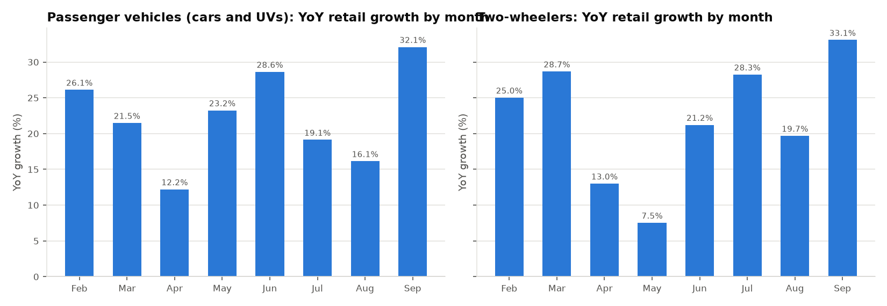
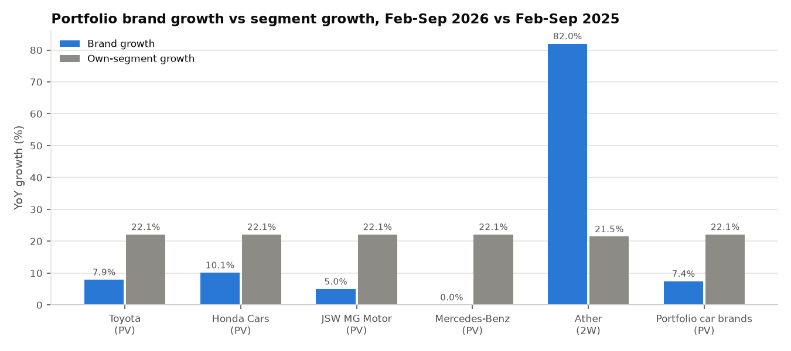
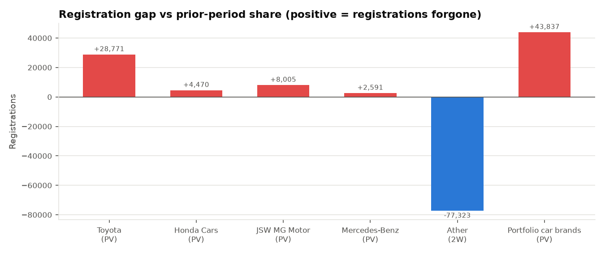
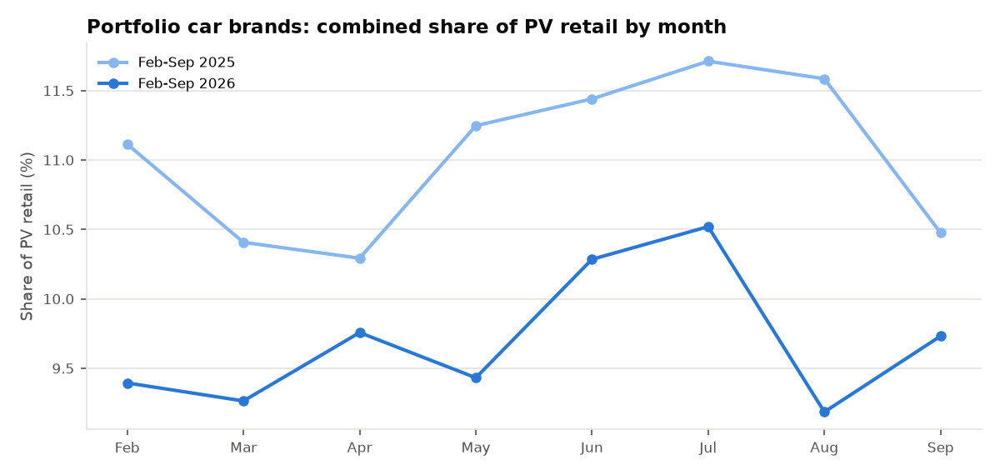
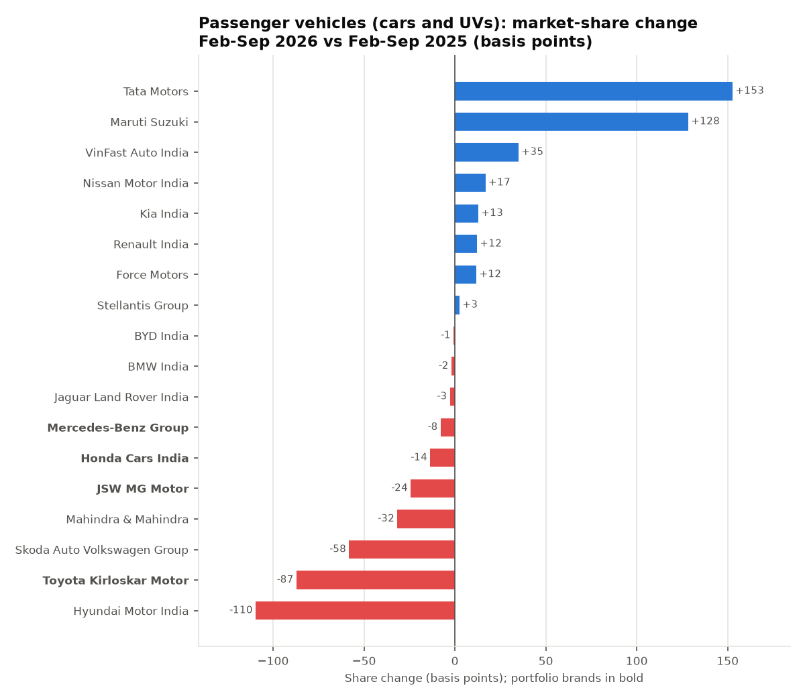
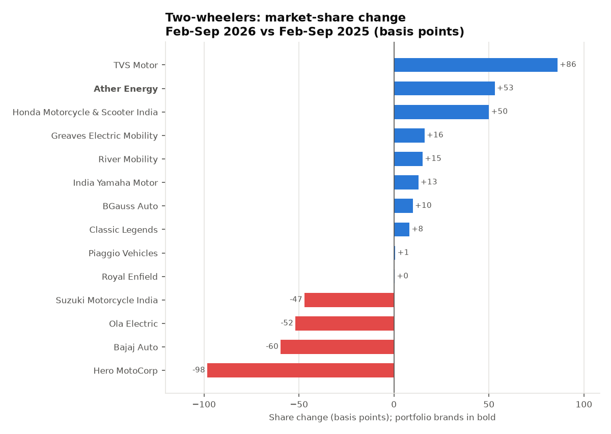
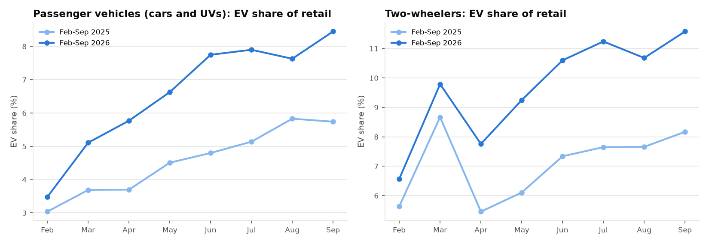

# Automotive Retail Market Intelligence: Executive Report

**Scope:** India vehicle retail registrations, Feb-Sep 2026 vs Feb-Sep 2025. **Source:** FADA monthly vehicle retail data press releases (official, public). **Generated by:** `python python/auto_retail_analysis.py` from validated extracts; every number below is computed from `data/processed/fada/`, which is extracted from checksummed PDFs.

> Layer A uses real published data only. Dealership operating KPIs (Layer B) are simulated and are reported separately in `reports/dealership/`.

## 1. Headline answers

1. **Market growth.** Passenger-vehicle (car/UV) retail grew **+22.1%** (2,703,948 to 3,301,877); two-wheeler retail grew **+21.5%**.
2. **Portfolio vs segment.** The four portfolio car brands grew **+7.4%**, 14.7 pp slower than the PV market. Ather grew **+82.0%** against two-wheeler growth of +21.5%.
3. **Market share.** Combined portfolio PV share fell from **11.02%** to **9.70%** (-133 bps). Toyota's share moved -87 bps.
4. **Competitors.** Largest share gainers and losers in each segment are listed in section 4.
5. **EV adoption.** Weighted EV share of PV retail rose from **4.55%** to **6.60%**; of two-wheeler retail from 7.04% to 9.69%.
6. **Constant-share opportunity.** At its Feb-Sep 2025 share, the car portfolio would have retailed **364,032** units in Feb-Sep 2026 versus 320,195 actual: a gap of **43,837** registrations.
7. **Management attention.** Toyota: attention (growth -14.2 pp vs segment; share -87 bps; 28,771 registrations below constant share); Honda Cars: attention (growth -12.0 pp vs segment; share -14 bps; 4,470 registrations below constant share); JSW MG Motor: attention (growth -17.1 pp vs segment; share -24 bps; 8,005 registrations below constant share); Mercedes-Benz: attention (growth -22.1 pp vs segment; 2,591 registrations below constant share); Ather: on track / outperforming (none).

## 2. Segment growth

| Segment | Feb-Sep 2025 | Feb-Sep 2026 | Incremental units | YoY growth % |
|---|---|---|---|---|
| Two-wheelers | 11,991,359 | 14,564,261 | +2,572,902 | +21.46 |
| Passenger vehicles (cars and UVs) | 2,703,948 | 3,301,877 | +597,929 | +22.11 |

Monthly YoY growth (current month vs same month of prior year):

| segment | month | prior-year units | units | YoY % |
|---|---|---|---|---|
| 2W | 2026-02 | 1,360,155 | 1,700,505 | +25.02 |
| 2W | 2026-03 | 1,516,150 | 1,951,006 | +28.68 |
| 2W | 2026-04 | 1,695,638 | 1,916,258 | +13.01 |
| 2W | 2026-05 | 1,715,581 | 1,844,947 | +7.54 |
| 2W | 2026-06 | 1,508,378 | 1,828,458 | +21.22 |
| 2W | 2026-07 | 1,417,767 | 1,818,289 | +28.25 |
| 2W | 2026-08 | 1,432,537 | 1,714,610 | +19.69 |
| 2W | 2026-09 | 1,345,153 | 1,790,188 | +33.08 |
| PV | 2026-02 | 313,015 | 394,768 | +26.12 |
| PV | 2026-03 | 362,304 | 440,144 | +21.48 |
| PV | 2026-04 | 363,028 | 407,355 | +12.21 |
| PV | 2026-05 | 326,656 | 402,591 | +23.25 |
| PV | 2026-06 | 319,412 | 410,853 | +28.63 |
| PV | 2026-07 | 349,674 | 416,555 | +19.13 |
| PV | 2026-08 | 346,468 | 402,398 | +16.14 |
| PV | 2026-09 | 323,391 | 427,213 | +32.10 |

Note: FADA describes September 2025 as depressed by purchase deferral ahead of GST 2.0 (effective 22 Sep 2025), so September 2026 YoY growth is flattered by a low base.

## 3. Portfolio brand performance

Each brand is benchmarked only against its own segment: car brands against total PV retail, Ather against total two-wheeler retail.

| brand | segment | Feb-Sep 2025 | Feb-Sep 2026 | growth % | segment growth % | gap pp | share prior % | share current % | share chg bps | constant-share units | registration gap |
|---|---|---|---|---|---|---|---|---|---|---|---|
| Toyota | PV | 202,405 | 218,392 | +7.90 | +22.11 | -14.21 | 7.49 | 6.61 | -87.1 | 247,163 | +28,771 |
| Honda Cars | PV | 37,271 | 41,043 | +10.12 | +22.11 | -11.99 | 1.38 | 1.24 | -13.5 | 45,513 | +4,470 |
| JSW MG Motor | PV | 46,705 | 49,028 | +4.97 | +22.11 | -17.14 | 1.73 | 1.48 | -24.2 | 57,033 | +8,005 |
| Mercedes-Benz | PV | 11,729 | 11,732 | +0.03 | +22.11 | -22.09 | 0.43 | 0.36 | -7.8 | 14,323 | +2,591 |
| Ather | 2W | 127,740 | 232,471 | +81.99 | +21.46 | +60.53 | 1.07 | 1.60 | +53.1 | 155,148 | -77,323 |
| Portfolio car brands | PV | 298,110 | 320,195 | +7.41 | +22.11 | -14.70 | 11.02 | 9.70 | -132.8 | 364,032 | +43,837 |

## 4. OEM market share and competitor moves

Only OEMs that FADA lists in every month of both periods are ranked. Share change uses weighted period shares (summed units / summed segment total), not averages of monthly percentages.

| segment | list | OEM | Feb-Sep 2025 | Feb-Sep 2026 | share prior % | share current % | chg bps | growth % |
|---|---|---|---|---|---|---|---|---|
| 2W | Top share gainers | TVS Motor | 2,272,492 | 2,885,484 | 18.95 | 19.81 | +86.1 | +26.97 |
| 2W | Top share gainers | Ather Energy | 127,740 | 232,471 | 1.07 | 1.60 | +53.1 | +81.99 |
| 2W | Top share gainers | Honda Motorcycle & Scooter India | 2,961,563 | 3,669,847 | 24.70 | 25.20 | +50.0 | +23.92 |
| 2W | Top share gainers | Greaves Electric Mobility | 35,175 | 66,252 | 0.29 | 0.45 | +16.2 | +88.35 |
| 2W | Top share gainers | River Mobility | 10,166 | 34,373 | 0.08 | 0.24 | +15.1 | +238.12 |
| 2W | Top share losers | Hero MotoCorp | 3,271,884 | 3,830,861 | 27.29 | 26.30 | -98.2 | +17.08 |
| 2W | Top share losers | Bajaj Auto | 1,296,772 | 1,488,203 | 10.81 | 10.22 | -59.6 | +14.76 |
| 2W | Top share losers | Ola Electric | 143,573 | 98,957 | 1.20 | 0.68 | -51.8 | -31.08 |
| 2W | Top share losers | Suzuki Motorcycle India | 710,918 | 794,964 | 5.93 | 5.46 | -47.0 | +11.82 |
| PV | Top share gainers | Tata Motors | 340,591 | 466,341 | 12.60 | 14.12 | +152.7 | +36.92 |
| PV | Top share gainers | Maruti Suzuki | 1,041,651 | 1,314,382 | 38.52 | 39.81 | +128.4 | +26.18 |
| PV | Top share gainers | VinFast Auto India | 6 | 11,594 | 0.00 | 0.35 | +35.1 | n/a |
| PV | Top share gainers | Nissan Motor India | 12,906 | 21,344 | 0.48 | 0.65 | +16.9 | +65.38 |
| PV | Top share gainers | Kia India | 161,733 | 201,760 | 5.98 | 6.11 | +12.9 | +24.75 |
| PV | Top share losers | Hyundai Motor India | 338,583 | 377,282 | 12.52 | 11.43 | -109.6 | +11.43 |
| PV | Top share losers | Toyota Kirloskar Motor | 202,405 | 218,392 | 7.49 | 6.61 | -87.1 | +7.90 |
| PV | Top share losers | Skoda Auto Volkswagen Group | 69,730 | 65,940 | 2.58 | 2.00 | -58.2 | -5.44 |
| PV | Top share losers | Mahindra & Mahindra | 367,858 | 438,763 | 13.60 | 13.29 | -31.6 | +19.28 |
| PV | Top share losers | JSW MG Motor | 46,705 | 49,028 | 1.73 | 1.48 | -24.2 | +4.97 |

Full table: `tables/oem_period_share.csv`.

## 5. EV adoption

EV units are **derived**: FADA publishes the EV percentage of each segment's retail to two decimals; EV units = share x segment total. Period shares are weighted by monthly segment volume. PV and 2W EV shares are never combined.

| segment | EV units (est) Feb-Sep 2025 | EV units (est) Feb-Sep 2026 | EV share prior % | EV share current % | chg bps | EV growth % | segment growth % |
|---|---|---|---|---|---|---|---|
| 2W | 844,372 | 1,410,702 | 7.04 | 9.69 | +264 | +67.1 | +21.5 |
| PV | 123,116 | 217,977 | 4.55 | 6.60 | +205 | +77.1 | +22.1 |

Illustrative (assumes Ather retails only battery-electric two-wheelers, an analyst assumption rather than a FADA field): Ather's share of estimated two-wheeler EV retail.

| brand | segment | Feb-Sep 2025 | Feb-Sep 2026 | share of 2W EV prior % | share of 2W EV current % | chg bps |
|---|---|---|---|---|---|---|
| Ather | 2W | 127,740 | 232,471 | 15.13 | 16.48 | +135 |

## 6. Management attention

Rules (illustrative thresholds in `config/market_analysis.yaml`, not industry benchmarks): growth gap <= -5.0 pp, share change <= -10.0 bps, registration gap >= 1,000 units.

| brand | segment | status | triggers | growth % | segment growth % | share chg bps | registration gap |
|---|---|---|---|---|---|---|---|
| Toyota | PV | Attention | growth -14.2 pp vs segment; share -87 bps; 28,771 registrations below constant share | +7.90 | +22.11 | -87.1 | +28,771 |
| Honda Cars | PV | Attention | growth -12.0 pp vs segment; share -14 bps; 4,470 registrations below constant share | +10.12 | +22.11 | -13.5 | +4,470 |
| JSW MG Motor | PV | Attention | growth -17.1 pp vs segment; share -24 bps; 8,005 registrations below constant share | +4.97 | +22.11 | -24.2 | +8,005 |
| Mercedes-Benz | PV | Attention | growth -22.1 pp vs segment; 2,591 registrations below constant share | +0.03 | +22.11 | -7.8 | +2,591 |
| Ather | 2W | On track / outperforming | none | +81.99 | +21.46 | +53.1 | -77,323 |
| Portfolio car brands | PV | Attention | growth -14.7 pp vs segment; share -133 bps; 43,837 registrations below constant share | +7.41 | +22.11 | -132.8 | +43,837 |

## 7. Cross-check of previously quoted figures

Figures quoted for this project before the analysis was built were treated as claims and re-derived from source data.

| figure | quoted value | reproduced | status | note |
|---|---|---|---|---|
| Car market growth | +22.1% | 22.11 | Reproduced |  |
| Portfolio car-brand growth | +7.4% | 7.41 | Reproduced |  |
| Portfolio market share (prior) | 11.02% | 11.02 | Reproduced |  |
| Portfolio market share (current) | 9.70% | 9.70 | Reproduced |  |
| Toyota share change | -87 bps | -87.14 | Reproduced |  |
| Ather growth | +82.0% | 81.99 | Reproduced |  |
| Two-wheeler market growth | +21.5% | 21.46 | Reproduced |  |
| Car EV retail share (prior) | 3.48% | 4.55 | Does not reproduce as stated | Not a period comparison: 3.48% and 8.45% are the single months 2026-02 and 2026-09. Weighted period shares are shown in 'reproduced'. |
| Car EV retail share (current) | 8.45% | 6.60 | Does not reproduce as stated | Not a period comparison: 3.48% and 8.45% are the single months 2026-02 and 2026-09. Weighted period shares are shown in 'reproduced'. |

## 8. Data quality and reconciliation

- Extraction checks: **917 of 917 passed** (`data/processed/fada/extraction_checks.csv`): OEM rows sum to each published segment total for every segment-month; group rows equal the sum of their members; every recomputed share matches FADA's printed share within rounding; OEM totals equal the category summary table.
- The analysis re-validates schema, periods, duplicates, OEM mapping coverage and reconciliation before computing anything.
- RTO coverage per release: 2026-02: 1,459/1,464 RTOs, collated 2026-03-02; 2026-03: 1,463/1,466 RTOs, collated 2026-04-02; 2026-04: 1,463/1,466 RTOs, collated 2026-05-03; 2026-05: 1,464/1,467 RTOs, collated 2026-06-05; 2026-06: 1,464/1,467 RTOs, collated 2026-07-04; 2026-07: 1,465/1,468 RTOs, collated 2026-08-05; 2026-08: 1,467/1,469 RTOs, collated 2026-09-04; 2026-09: 1,468/1,469 RTOs, collated 2026-10-03.
- FADA revises earlier months in later releases (14 category-months differ between releases; see `data/processed/fada/category_revisions_across_releases.csv`). OEM detail exists only in each month's own release, so all shares use those first-published OEM tables consistently.
- Prior-year (2025) values are the comparison columns printed in the 2026 releases.

## 9. Method notes

- YoY growth % = (current / prior - 1) x 100; NaN when the prior value is zero or missing.
- Market share % = OEM units / segment units x 100, with the OEM's own segment as denominator.
- Share change bps = (current share % - prior share %) x 100.
- Constant-share registrations = current segment units x prior share % / 100; registration gap = constant-share registrations - actual registrations.
- Group rows (e.g. Mercedes-Benz Group, Skoda Auto Volkswagen Group) are used; their member rows are never added again. Mercedes-Benz = Mercedes-Benz India + Mercedes-Benz AG + Daimler AG + 'Mercedes Benz' rows.
- FADA prints '-' for nil registrations in some member rows (with a 0.00% share); these are stored as 0 with `reported_as_dash = True`.
- Presentation rounding only; calculations use full precision.
