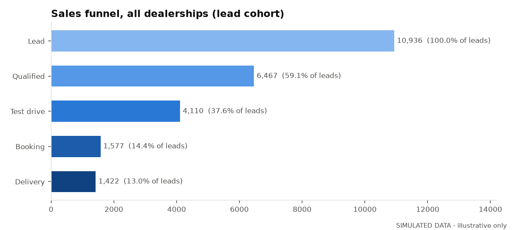
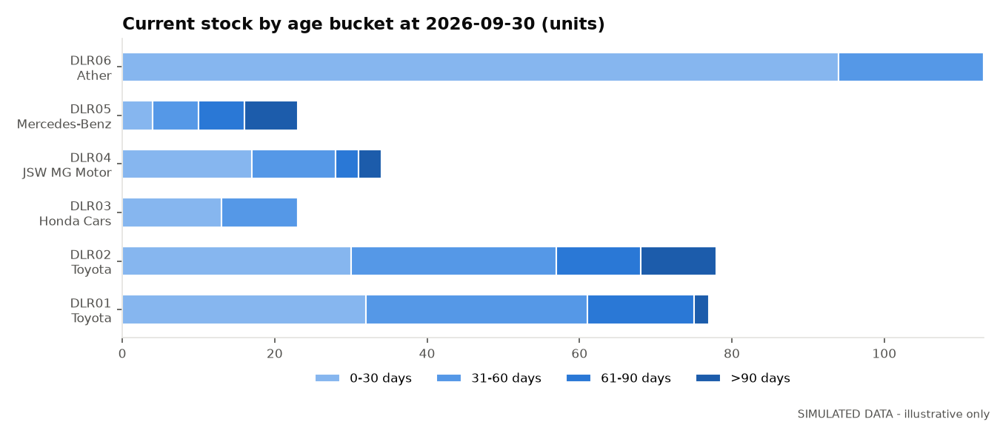

# Dealership Operations KPI Report (SIMULATED DATA)

> **All figures in this report are generated by a seeded simulation** (`python/dealership_kpi_simulation.py`, seed 20260930, 2026-02-01 to 2026-09-30). They illustrate the KPI framework and do not describe any real dealership, brand, salesperson or customer. Thresholds are illustrative business rules unless a published basis is stated.

## 1. Sales funnel (lead cohort through the snapshot date)

10,936 leads -> 6,467 qualified -> 4,110 test drives -> 1,577 bookings -> 1,422 deliveries (lead-to-delivery 13.0%). Leads created near the snapshot date have had less time to convert; they are counted as open, not lost.

| dealership_id | brand | leads | qualified | test_drives | bookings | deliveries | lead_to_qualified_pct | qualified_to_test_drive_pct | test_drive_to_booking_pct | booking_to_delivery_pct | lead_to_delivery_pct |
|---|---|---|---|---|---|---|---|---|---|---|---|
| DLR01 | Toyota | 2107 | 1216 | 740 | 277 | 250 | 57.7 | 60.9 | 37.4 | 90.3 | 11.9 |
| DLR02 | Toyota | 2127 | 1266 | 807 | 314 | 274 | 59.5 | 63.7 | 38.9 | 87.3 | 12.9 |
| DLR03 | Honda Cars | 1423 | 831 | 504 | 149 | 132 | 58.4 | 60.6 | 29.6 | 88.6 | 9.3 |
| DLR04 | JSW MG Motor | 1374 | 817 | 441 | 117 | 101 | 59.5 | 54.0 | 26.5 | 86.3 | 7.4 |
| DLR05 | Mercedes-Benz | 457 | 274 | 181 | 52 | 39 | 60.0 | 66.1 | 28.7 | 75.0 | 8.5 |
| DLR06 | Ather | 3448 | 2063 | 1437 | 668 | 626 | 59.8 | 69.7 | 46.5 | 93.7 | 18.2 |
| ALL | All | 10936 | 6467 | 4110 | 1577 | 1422 | 59.1 | 63.6 | 38.4 | 90.2 | 13.0 |

## 2. Lost-lead reasons

| lost_stage | lost_reason | lost_leads | share_of_lost_pct |
|---|---|---|---|
| Booking | Booking cancelled - delivery wait | 26 | 0.3 |
| Booking | Booking cancelled - changed mind | 19 | 0.2 |
| Booking | Booking cancelled - finance | 19 | 0.2 |
| Lead | Only researching | 1095 | 12.3 |
| Lead | Duplicate enquiry | 1067 | 12.0 |
| Lead | Not reachable | 1041 | 11.7 |
| Lead | Budget mismatch | 1038 | 11.7 |
| Qualified | No test drive slot accepted | 591 | 6.7 |
| Qualified | Purchase postponed | 545 | 6.1 |
| Qualified | Finance not approved | 540 | 6.1 |
| Qualified | Bought competitor brand | 511 | 5.8 |
| Test drive | Product fit concerns | 501 | 5.6 |
| Test drive | Bought competitor brand | 489 | 5.5 |
| Test drive | Purchase postponed | 485 | 5.5 |
| Test drive | Finance not approved | 466 | 5.2 |
| Test drive | Price / discount expectation | 447 | 5.0 |

## 3. Lead follow-up

First-contact standard: within 4 hours (illustrative).

| dealership_id | first_contact_sla_pct | median_first_contact_hours | p90_first_contact_hours |
|---|---|---|---|
| DLR01 | 73.2 | 2.3 | 7.3 |
| DLR02 | 79.3 | 1.8 | 6.1 |
| DLR03 | 74.3 | 2.3 | 6.3 |
| DLR04 | 76.3 | 2.0 | 6.8 |
| DLR05 | 70.2 | 2.4 | 8.1 |
| DLR06 | 81.1 | 1.7 | 5.7 |

## 4. Inventory and ageing

Ageing buckets use inclusive upper bounds [30, 60, 90] days; aged inventory = older than 60 days. Sell-through = deliveries / (opening stock + receipts). Turnover = cost of vehicles delivered / average month-end stock cost, annualised. Days of supply = closing stock / average daily deliveries over the last 30 days.

| dealership_id | brand | segment | opening_stock_units | receipts_units | deliveries_units | closing_stock_units | closing_stock_cost_inr | stock_0-30_days | stock_31-60_days | stock_61-90_days | stock_>90_days | aged_units | aged_inventory_share_pct | avg_stock_age_days | sell_through_pct | inventory_turnover_annualised | avg_days_in_inventory_delivered | deliveries_last_30_days | days_of_supply | top_model_stock_share_pct | stock_hhi |
|---|---|---|---|---|---|---|---|---|---|---|---|---|---|---|---|---|---|---|---|---|---|
| DLR01 | Toyota | PV | 38 | 289 | 250 | 77 | 150,148,500 | 32 | 29 | 14 | 2 | 16 | 20.8 | 39.7 | 76.5 | 5.00 | 59.6 | 27 | 85.6 | 31.2 | 2420 |
| DLR02 | Toyota | PV | 43 | 309 | 274 | 78 | 159,216,000 | 30 | 27 | 11 | 10 | 21 | 26.9 | 47.1 | 77.8 | 5.79 | 57.8 | 44 | 53.2 | 30.8 | 2587 |
| DLR03 | Honda Cars | PV | 26 | 129 | 132 | 23 | 23,622,000 | 13 | 10 | 0 | 0 | 0 | 0.0 | 27.5 | 85.2 | 5.81 | 63.5 | 20 | 34.5 | 52.2 | 4631 |
| DLR04 | JSW MG Motor | PV | 21 | 114 | 101 | 34 | 70,680,000 | 17 | 11 | 3 | 3 | 6 | 17.6 | 40.5 | 74.8 | 3.62 | 76.6 | 13 | 78.5 | 35.3 | 2734 |
| DLR05 | Mercedes-Benz | PV | 13 | 49 | 39 | 23 | 226,920,000 | 4 | 6 | 6 | 7 | 13 | 56.5 | 71.0 | 62.9 | 2.59 | 97.1 | 8 | 86.2 | 56.5 | 5085 |
| DLR06 | Ather | 2W | 66 | 673 | 626 | 113 | 15,744,900 | 94 | 19 | 0 | 0 | 0 | 0.0 | 18.5 | 84.7 | 10.13 | 35.4 | 71 | 47.7 | 50.4 | 5000 |

## 5. Management actions triggered

22 of 41 rule checks breached their threshold.

| dealership_id | brand | kpi | actual | comparator | threshold | responsible_role | review_cadence | recommended_action | threshold_basis |
|---|---|---|---|---|---|---|---|---|---|
| DLR01 | Toyota | aged_inventory_share_pct | 20.8 | > | 15.0 | Inventory Manager | Weekly | List aged VINs, set model-specific retail support, pause replenishment orders for affected models. | Illustrative business rule |
| DLR02 | Toyota | aged_inventory_share_pct | 26.9 | > | 15.0 | Inventory Manager | Weekly | List aged VINs, set model-specific retail support, pause replenishment orders for affected models. | Illustrative business rule |
| DLR04 | JSW MG Motor | aged_inventory_share_pct | 17.6 | > | 15.0 | Inventory Manager | Weekly | List aged VINs, set model-specific retail support, pause replenishment orders for affected models. | Illustrative business rule |
| DLR05 | Mercedes-Benz | aged_inventory_share_pct | 56.5 | > | 15.0 | Inventory Manager | Weekly | List aged VINs, set model-specific retail support, pause replenishment orders for affected models. | Illustrative business rule |
| DLR01 | Toyota | days_of_supply | 85.6 | > | 21.0 | Dealer Principal | Weekly | Align OEM dispatch plan to retail run-rate; escalate excess allocation with the OEM zonal office. | FADA recommends a 21-day PV inventory level (FADA Sep'26 release); applied here to simulated stock |
| DLR02 | Toyota | days_of_supply | 53.2 | > | 21.0 | Dealer Principal | Weekly | Align OEM dispatch plan to retail run-rate; escalate excess allocation with the OEM zonal office. | FADA recommends a 21-day PV inventory level (FADA Sep'26 release); applied here to simulated stock |
| DLR03 | Honda Cars | days_of_supply | 34.5 | > | 21.0 | Dealer Principal | Weekly | Align OEM dispatch plan to retail run-rate; escalate excess allocation with the OEM zonal office. | FADA recommends a 21-day PV inventory level (FADA Sep'26 release); applied here to simulated stock |
| DLR04 | JSW MG Motor | days_of_supply | 78.5 | > | 21.0 | Dealer Principal | Weekly | Align OEM dispatch plan to retail run-rate; escalate excess allocation with the OEM zonal office. | FADA recommends a 21-day PV inventory level (FADA Sep'26 release); applied here to simulated stock |
| DLR05 | Mercedes-Benz | days_of_supply | 86.2 | > | 21.0 | Dealer Principal | Weekly | Align OEM dispatch plan to retail run-rate; escalate excess allocation with the OEM zonal office. | FADA recommends a 21-day PV inventory level (FADA Sep'26 release); applied here to simulated stock |
| DLR01 | Toyota | first_contact_sla_pct | 73.2 | < | 80.0 | CRM Manager | Daily | Re-route unassigned leads, enforce call-back queue, review salesperson lead load. | Illustrative business rule |
| DLR02 | Toyota | first_contact_sla_pct | 79.3 | < | 80.0 | CRM Manager | Daily | Re-route unassigned leads, enforce call-back queue, review salesperson lead load. | Illustrative business rule |
| DLR03 | Honda Cars | first_contact_sla_pct | 74.3 | < | 80.0 | CRM Manager | Daily | Re-route unassigned leads, enforce call-back queue, review salesperson lead load. | Illustrative business rule |
| DLR04 | JSW MG Motor | first_contact_sla_pct | 76.3 | < | 80.0 | CRM Manager | Daily | Re-route unassigned leads, enforce call-back queue, review salesperson lead load. | Illustrative business rule |
| DLR05 | Mercedes-Benz | first_contact_sla_pct | 70.2 | < | 80.0 | CRM Manager | Daily | Re-route unassigned leads, enforce call-back queue, review salesperson lead load. | Illustrative business rule |
| DLR03 | Honda Cars | test_drive_to_booking_pct | 29.6 | < | 30.0 | Sales Manager | Weekly | Review test-drive feedback and offer structure; coach salespeople below team median. | Illustrative business rule |
| DLR04 | JSW MG Motor | test_drive_to_booking_pct | 26.5 | < | 30.0 | Sales Manager | Weekly | Review test-drive feedback and offer structure; coach salespeople below team median. | Illustrative business rule |
| DLR05 | Mercedes-Benz | test_drive_to_booking_pct | 28.7 | < | 30.0 | Sales Manager | Weekly | Review test-drive feedback and offer structure; coach salespeople below team median. | Illustrative business rule |
| DLR04 | JSW MG Motor | lead_to_delivery_pct | 7.4 | < | 9.0 | General Manager - Sales | Monthly | Audit lead-source quality and spend; rebalance marketing budget toward converting sources. | Illustrative business rule |
| DLR05 | Mercedes-Benz | lead_to_delivery_pct | 8.5 | < | 9.0 | General Manager - Sales | Monthly | Audit lead-source quality and spend; rebalance marketing budget toward converting sources. | Illustrative business rule |
| DLR03 | Honda Cars | top_model_stock_share_pct | 52.2 | > | 45.0 | Dealer Principal | Monthly | Rebalance order mix; agree transfer of excess units with sister dealerships. | Illustrative business rule |
| DLR05 | Mercedes-Benz | top_model_stock_share_pct | 56.5 | > | 45.0 | Dealer Principal | Monthly | Rebalance order mix; agree transfer of excess units with sister dealerships. | Illustrative business rule |
| DLR06 | Ather | top_model_stock_share_pct | 50.4 | > | 45.0 | Dealer Principal | Monthly | Rebalance order mix; agree transfer of excess units with sister dealerships. | Illustrative business rule |

## 6. Data integrity

Generated tables passed all integrity checks (unique keys, foreign keys, salesperson-dealership and model-brand consistency, stage order and dates, one delivery per booking and per vehicle, delivery after receipt). Row counts: dim_dealership: 6, dim_salesperson: 35, dim_vehicle_model: 17, fact_lead_funnel: 10,936, fact_vehicle_inventory: 1,770, fact_vehicle_delivery: 1,422, fact_inventory_snapshot: 2,640, simulation_latent_parameters: 35.
